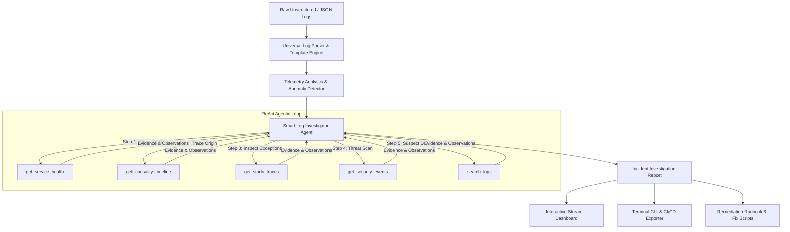

# 🔍 Smart Log Investigation AI Agent

> **Autonomous Agentic AI for Distributed Log Analysis, Root Cause Diagnosis (RCA), Security Threat Intelligence, and Automated Incident Runbooks.**

---

## 🌟 Overview

In modern cloud-native and microservice architectures, an outage or security breach generates tens of thousands of noisy log lines across dozens of services. Human SREs and DevSecOps engineers spend critical hours manually sifting through logs, trying to isolate the true root cause from downstream cascading symptoms.

**Smart Log Investigation AI Agent** is an end-to-end autonomous agentic solution designed to:
1. **Ingest & Parse Multi-Format Logs**: Seamlessly handles Syslog, RFC 5424, Nginx/Apache access & error logs, structured JSON logs (Kubelet, CloudWatch), and multi-line stack traces.
2. **Detect Anomalies & Correlate Causality**: Statistically isolates error bursts, latency anomalies, resource exhaustion (OOM), and cyber threat patterns (SQLi, brute-force authentication attacks).
3. **Execute an Autonomous ReAct Investigation Loop**: Uses specialized tools to dynamically interrogate logs (`get_service_health`, `get_causality_timeline`, `get_stack_traces`, `get_security_events`, `search_logs`).
4. **Deliver Complete Root Cause Analysis (RCA)**: Pinpoints "Patient Zero" (the primary culprit service), traces the downstream blast radius, and provides actionable remediation runbooks with executable terminal commands.
5. **Dual-Mode AI Engine**: Fully operational with **Google Gemini**, **OpenAI GPT-4o**, or **Local Ollama**, with a built-in **Smart Heuristic Engine** that runs 100% offline with zero external API dependencies.

---

## 🏗️ Architecture



---

## 📁 Project Structure

```
SmartLogInvestigationAgent/
├── app.py                     # Interactive Streamlit Web Application
├── cli.py                     # Command-line interface for automated investigations
├── requirements.txt           # Project dependencies
├── .env.example               # Configuration template for LLM providers
├── README.md                  # Complete documentation and setup guide
├── data/
│   └── sample_logs/           # Pre-packaged real-world incident log datasets
│       ├── microservices_cascading_failure.log   # Postgres Pool Exhaustion -> 504 Gateway Timeouts
│       ├── security_incident_bruteforce_sqli.log # Brute Force + SQL Injection + Credential Dump
│       └── k8s_resource_oom_crashloop.log        # Kubernetes Java Heap OOMKilled & CrashLoopBackOff
├── src/
│   ├── config.py              # Environment configuration & provider settings
│   ├── models/
│   │   └── log_model.py       # Pydantic schemas: LogEntry, Anomaly, IncidentReport, AgentAction
│   ├── parsers/
│   │   ├── log_parser.py      # Universal multi-line and JSON log parser
│   │   └── pattern_extractor.py # Token abstraction and template masking (<IP>, <UUID>, etc.)
│   ├── analytics/
│   │   ├── anomaly_detector.py # Burst detection, security triggers, and OOM heuristics
│   │   └── correlator.py      # Cross-service chronology and blast radius calculator
│   ├── agent/
│   │   ├── investigator_agent.py # Core Autonomous Agent ReAct workflow
│   │   ├── tools.py           # Investigation tools suite for log querying & inspection
│   │   ├── llm_client.py      # Provider interface (Gemini, OpenAI, Ollama, Offline)
│   │   └── prompts.py         # SRE & Incident Commander persona prompts
│   └── reporting/
│       └── report_generator.py # Markdown, JSON, and Rich report generator
└── tests/                     # Automated unit and integration test suite
    ├── test_parser.py
    ├── test_anomaly_detector.py
    └── test_agent.py
```

---

## 🚀 Quick Start Guide

### 1. Prerequisites & Installation
Ensure you have Python 3.10+ installed.

```bash
# Clone or navigate into the project directory
cd SmartLogInvestigationAgent

# Install dependencies
pip install -r requirements.txt
```

### 2. Configuration (Optional)
The agent works **100% out of the box in offline mode** without any API keys. If you wish to use an external LLM, copy `.env.example` to `.env` and provide your credentials:

```bash
cp .env.example .env
```

Edit `.env`:
```ini
LLM_PROVIDER=gemini # or openai, ollama, offline
GEMINI_API_KEY=your_gemini_api_key_here
```

---

## 💻 Usage

### Option A: Launch Interactive Web Dashboard
Run the Streamlit application:
```bash
streamlit run app.py
```
- Open `http://localhost:8501` in your browser.
- Select one of the pre-loaded incident scenarios or upload any custom log file (`.log`, `.txt`, `.json`, `.csv`).
- Click **"🚀 Run Autonomous Investigation"** to watch the agent reason through the incident step-by-step!
- Inspect interactive Plotly timeline charts, error distribution charts, and download the full report in Markdown or JSON.

### Option B: Command Line Interface (CLI)
Run an automated investigation directly from your terminal:

```bash
# Investigate microservices cascading outage
python cli.py --file data/sample_logs/microservices_cascading_failure.log --export incident_report.md

# Investigate security breach
python cli.py --file data/sample_logs/security_incident_bruteforce_sqli.log --export security_report.md

# Investigate Kubernetes OOM crash
python cli.py --file data/sample_logs/k8s_resource_oom_crashloop.log --export k8s_report.md
```

---

## 🧪 Running Automated Tests

Run the complete test suite using `pytest`:

```bash
pytest -v
```

All tests cover:
- Multi-line stack trace stitching and parsing.
- Dynamic token abstraction and template extraction.
- Statistical error burst and security anomaly detection.
- Cross-service causality and blast radius calculation.
- End-to-end agentic ReAct loop and report generation.

---

## 🛡️ Pre-Packaged Incident Scenarios

1. **💥 Microservices Cascading Outage (`microservices_cascading_failure.log`)**:
   - High traffic surge saturates PostgreSQL connection slots (100/100).
   - `auth-service` experiences HikariCP checkout timeouts (30,000ms).
   - `order-service` circuit breakers trip (`CallNotPermittedException`).
   - `api-gateway` throws HTTP 504 Gateway Timeouts, causing client-facing 500 errors in `checkout-frontend`.
   - **Agent Diagnosis**: Accurately isolates `postgres-primary` as root culprit instead of blaming frontend checkout services.

2. **🛡️ Targeted Security Breach (`security_incident_bruteforce_sqli.log`)**:
   - Threat actor IP `198.51.100.42` runs automated brute-force attacks on `/api/v1/auth/login`.
   - Shifts attack vector to SQL Injection (`UNION SELECT username, password_hash FROM users--`).
   - Attempts privilege escalation against `/api/v1/admin/sudo_grant`.
   - **Agent Diagnosis**: Flags critical security incident, identifies actor IP, and produces WAF IP blocking and token revocation runbooks.

3. **☸️ Kubernetes Out-of-Memory (`k8s_resource_oom_crashloop.log`)**:
   - `billing-worker` pod processes unpaginated batch invoice payloads.
   - JVM heap memory escalates, triggering `java.lang.OutOfMemoryError`.
   - Kubelet sends SIGKILL `OOMKilled (Exit Code 137)`.
   - Pod enters `CrashLoopBackOff`, causing upstream queue backlog.
   - **Agent Diagnosis**: Pinpoints unpaginated batch memory leak and provides `kubectl` memory limit adjustments and rollout restart commands.

---

## 📄 License
MIT License. Built with ❤️ for Site Reliability and DevSecOps Engineers.
# SmartLogInvestigationAgen
